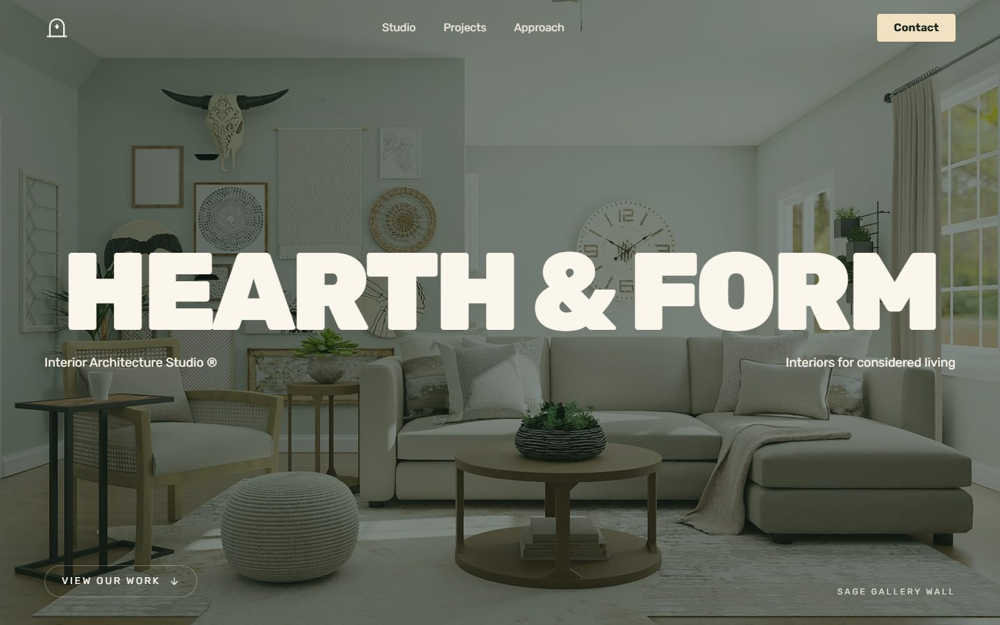
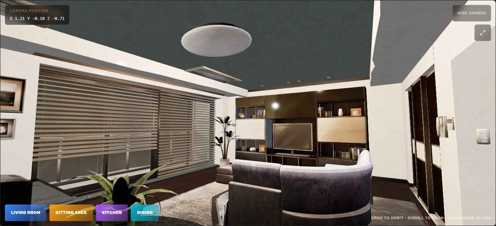
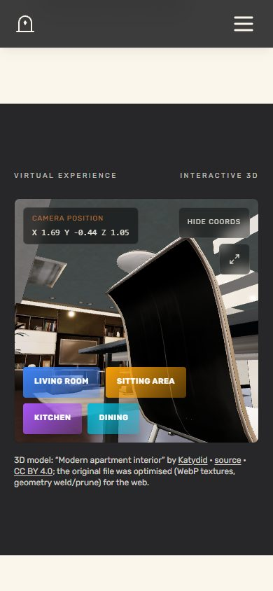

# Hearth & Form

An original, portfolio-ready one-page website for an interior-design & space-styling
studio. It recreates the *visual experience* of a reference site — the editorial
typography, the calm warm palette, scroll reveals, the project/approach/service
interactions, and an interactive 3D apartment walkthrough — but as a fully distinct
brand with its own name, identity, wording, logo, imagery, and implementation.

> **Live:** https://hearth-and-form.vercel.app



## Tech stack

- [Vite](https://vitejs.dev/) + [React 18](https://react.dev/)
- [Tailwind CSS v4](https://tailwindcss.com/) (design tokens via `@theme`)
- [Framer Motion](https://www.framer.com/motion/) for scroll/UI motion
- [React Three Fiber](https://r3f.docs.pmnd.rs/) + [drei](https://github.com/pmndrs/drei) + [three.js](https://threejs.org/) for the 3D scene
- [Lucide](https://lucide.dev/) icons
- Self-hosted [Rubik](https://fonts.google.com/specimen/Rubik) typeface (SIL OFL 1.1) via `@fontsource`

## Sections

Hero (wordmark + crossfading interiors) · Studio/About · Style gallery (auto-advancing)
· Selected projects (grayscale→colour on hover) · Services (glass cards) · How we work
(hover-invert cells) · **Virtual Experience** (interactive 3D apartment with room
hotspots, orbit + zoom, live camera HUD, fullscreen) · Testimonials · Footer.



Responsive from 320 px up, with a full-screen mobile menu:



## Getting started

```bash
npm install
npm run dev        # local dev server
npm run build      # production build -> dist/
npm run preview    # preview the production build
npm run lint       # ESLint
```

## 3D model

- **Model:** "Modern apartment interior" by **Katydid** on Sketchfab
  <https://sketchfab.com/3d-models/modern-apartment-interior-400c9069181a4342a7142433dfa3466e>
- **License:** **CC-BY 4.0** (attribution required; commercial use permitted). Attribution
  is shown on the site at the 3D section.
- The source `.glb` was optimised with `@gltf-transform` (WebP textures, dedup, weld,
  prune) from ~10 MB to ~5.4 MB, keeping Draco compression **off** so the browser needs
  no extra decoder.
- The scene auto-frames the model (bounding-box normalisation), provides a loading
  progress bar, a no-WebGL fallback image, respects `prefers-reduced-motion`, and reserves
  an aspect-ratio box so there is no layout shift.

## Imagery

Interior photographs are sourced from [Unsplash](https://unsplash.com/) and served
locally from `public/images/` (no hotlinking). They are used under the
[Unsplash License](https://unsplash.com/license), which permits free commercial use
without attribution. Attribution is nevertheless provided in `CREDITS.md`.

## Typeface

Rubik, via [`@fontsource/rubik`](https://github.com/fontsource/fontsource), is licensed
under the SIL Open Font License 1.1.

## Honesty notes

- The studio name, location, project names and testimonial text are **original
  portfolio/demo content** created for this project, not real client references.
- There is **no backend**. The newsletter is clearly labelled a demo form and opens the
  visitor's email app; the contact address uses a reserved `.example` domain.
- **No social-media accounts** are linked, because no verified official accounts for
  this brand exist (removed rather than faked).

## Accessibility & performance

- Landmarks (`header`/`main`/`footer`), a skip link, exactly one `h1`, a section `h2`
  per block (the style gallery's is visually hidden), descriptive `alt` text that
  matches each photograph, `aria-label`/`aria-expanded` on the menu and viewer
  controls, and a visible `:focus-visible` outline token used site-wide.
- `prefers-reduced-motion` is honoured by the hero crossfade, the gallery autoplay,
  scroll reveals, the testimonial carousel and the CSS animation/transition reset.
- Grayscale photography effects are gated behind `@media (hover: hover)`, so touch
  devices never receive a permanently desaturated image.
- Text colours meet WCAG 2.1 AA against their backgrounds (the sage-on-paper palette
  leaves little headroom, so informational copy is not faded with `opacity`).
- Self-hosted fonts (no third-party render-blocking requests), `preload`ed LCP hero
  image with the remaining slides fetched after `load`, `loading="lazy"` photography,
  and the 3D canvas — plus its 5.4 MB `.glb` — mounted only once the section nears the
  viewport.

Measured on the production build (`vite preview`, desktop): zero console errors, every
network request `200`, `documentElement` horizontal overflow `0px` at 1440/1280/1024/
834/768/640/414/390/320 CSS px, and the `.glb` absent from the resource timeline until
the section is scrolled into view.

## Credits

See [`CREDITS.md`](./CREDITS.md).

## License

Original source code is released under the **MIT License** (see [`LICENSE`](./LICENSE)).
Third-party assets are **not** covered by MIT: the 3D model is CC-BY 4.0, photos are
Unsplash-licensed, and the typeface is OFL-1.1. See `CREDITS.md`.
